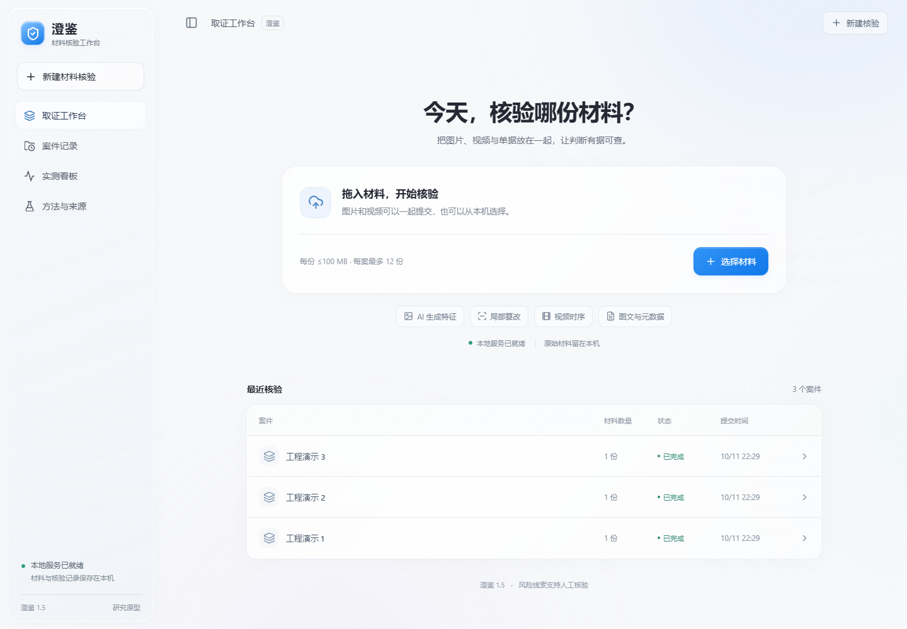

# 澄鉴 CLEARTRACE

本地运行的图片与视频材料取证工作台。它把生成痕迹、局部编辑、复制粘贴、元数据、OCR 与视频时序线索汇总为可追查的案件记录，供人工复核使用。



## 功能

- 图片来源分析：对公开支持的生成模型痕迹进行多分支检测。
- 局部篡改分析：输出可疑区域、热力图和原图坐标。
- 视频分析：抽取关键帧、保留实际时间戳并分析时序一致性。
- 辅助证据：读取元数据、执行 OCR、检查复制粘贴与业务字段冲突。
- 本地案件管理：保存输入摘要、配置、逐分支结果和 HTML/JSON 报告。
- 隐私优先：服务默认只监听 `127.0.0.1`，上传材料留在本机。

检测结果是调查线索，不是材料真实性或欺诈行为的自动定论。低风险同样不能证明材料真实。

## 运行环境

- Windows 10/11
- Python 3.12（需带 `py` 启动器）
- NVIDIA 显卡与可用的 CUDA 驱动
- Git
- 建议预留 25 GB 磁盘空间
- 仅在重新编译前端时需要 Node.js 20+

## 快速开始

### 1. 获取项目

```powershell
git clone https://github.com/God-Leelee/Lee.git
cd Lee
```

### 2. 准备运行模型

从 [GitHub Releases](https://github.com/God-Leelee/Lee/releases) 下载：

- `CLEARTRACE_Encoder_Weights.zip`
- `CLEARTRACE_Forensics_Assets.zip`

将两个压缩包解压到项目所在的父目录，允许它们合并到当前 `Lee` 目录。不要形成 `Lee/Lee` 嵌套。

如果不手动下载压缩包，初始化脚本也会根据 `models/runtime_assets.json` 获取缺失资源并校验 SHA-256。

### 3. 安装

在 PowerShell 中运行：

```powershell
Set-ExecutionPolicy -Scope Process Bypass
.\安装与初始化.ps1
```

初始化脚本会创建 `.venv`、安装固定依赖、检查 CUDA、校验模型资源并生成演示样例。

### 4. 启动

双击 `启动澄鉴.cmd`，等待模型加载完成后打开：

```text
http://127.0.0.1:8765/
```

也可以直接运行：

```powershell
.\.venv\Scripts\python.exe -X utf8 scripts\run_local.py
```

## 验证安装

```powershell
.\.venv\Scripts\python.exe -X utf8 scripts\verify_assets.py
.\.venv\Scripts\python.exe -X utf8 scripts\make_demo_samples.py
.\.venv\Scripts\python.exe -X utf8 scripts\reproduce_demo.py --base http://127.0.0.1:8765 --output runs/demo-new-001
```

`verify_assets.py` 检查模型、上游源码版本与哈希；`reproduce_demo.py` 会真实上传两张图片和一段视频，并核对报告、坐标、时间戳与运行分支。

## 支持的输入

- 图片：JPEG、PNG、WebP、BMP、TIFF、HEIC、HEIF、AVIF
- 视频：MP4、MOV、AVI、MKV、WebM

单次请求限制和视频采样参数由 `config.json` 控制。无法安全解码、文件损坏或超过限制的输入会被拒绝并返回明确错误。

## 项目结构

```text
backend/              FastAPI 服务、检测编排、报告与案件存储
frontend/             React/Vite 源码及已构建静态资源
models/               小型适配头与运行资源锁文件
scripts/              安装、启动、资源校验和回归工具
tests/                后端、接口、融合与格式测试
docs/                 架构、使用、测试和隐私说明
examples/             可公开分发的演示输入与参考输出
config.json           模型开关、阈值与运行限制
requirements.lock     Python 固定依赖
```

## 开发与测试

```powershell
.\.venv\Scripts\python.exe -m pytest -q
```

重新编译前端：

```powershell
cd frontend
npm.cmd ci
npm.cmd run build
```

更多信息见：

- [系统架构](docs/ARCHITECTURE.md)
- [使用说明](docs/USAGE.md)
- [测试说明](docs/TESTING.md)
- [数据与隐私](docs/PRIVACY.md)
- [第三方组件与许可](THIRD_PARTY_NOTICES.md)

## 许可证

本仓库是可查看源码的研究与评估项目，使用范围以 [LICENSE](LICENSE) 为准。模型和第三方组件仍受各自许可证约束，详见 [THIRD_PARTY_NOTICES.md](THIRD_PARTY_NOTICES.md)。
