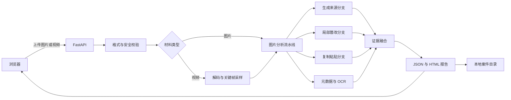

# 系统架构

CLEARTRACE 采用本地 Web 工作台结构：浏览器负责交互，FastAPI 负责文件校验、模型调度、证据融合、报告生成与案件存储。

## 后端

- `backend/app.py`：API、静态前端和案件访问入口。
- `backend/engine.py`：材料分析编排、超时与分支状态。
- `backend/models.py`：模型加载、设备选择和推理封装。
- `backend/media.py`：输入解码、元数据和视频采样。
- `backend/multimodal.py`、`backend/copy_move.py`、`backend/dense_copy.py`：OCR、图文线索与复制区域证据。
- `backend/fusion.py`：证据质量控制与风险融合。
- `backend/contracts.py` 和 `backend/app.py`：配置校验、案件及报告的本地持久化。
- `backend/reports.py`：可阅读的 HTML 报告。

## 前端

`frontend/src` 是 React/Vite 源码，`frontend/dist` 是仓库随附的构建结果。后端直接提供 `dist`，因此普通运行不依赖 Node.js。

## 资源锁定

`models/runtime_assets.json` 记录运行所需权重、上游仓库提交与 SHA-256。初始化和启动前的资源校验使用同一份清单，避免静默加载错误文件。

## 存储边界

服务默认监听回环地址。案件数据写入 `data/cases`，运行输出写入 `runs`；两者都被 `.gitignore` 排除。仓库不包含用户上传材料。
