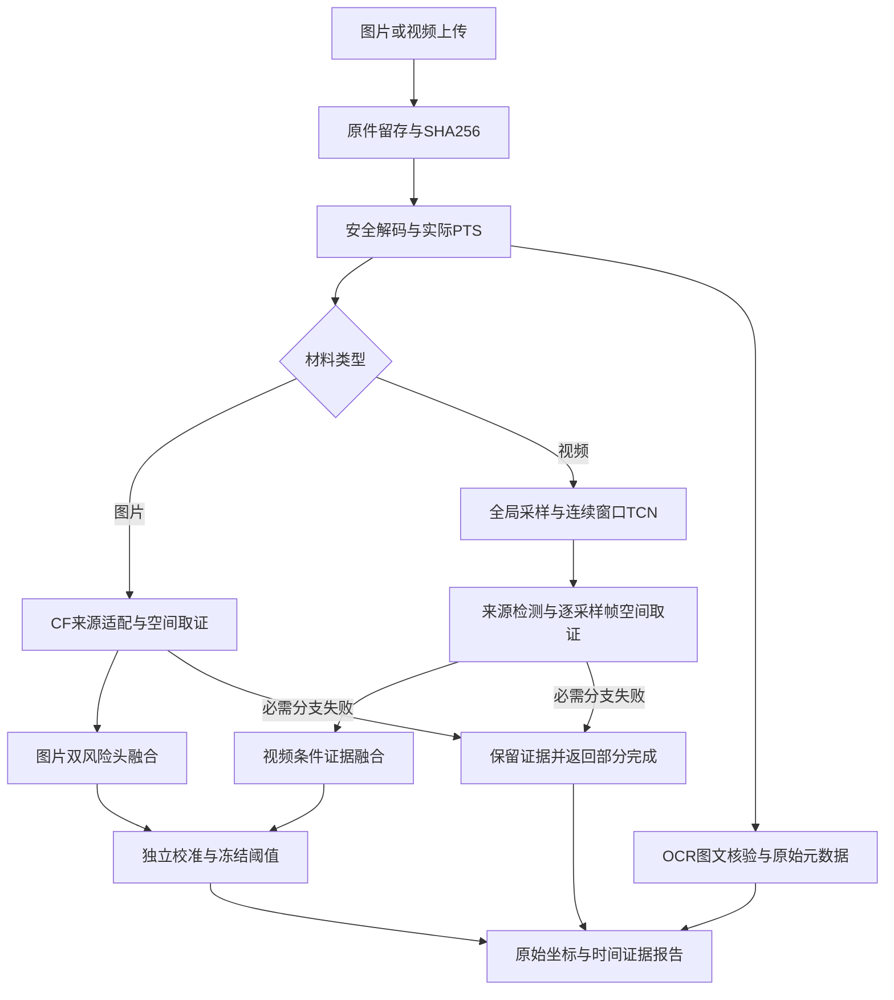
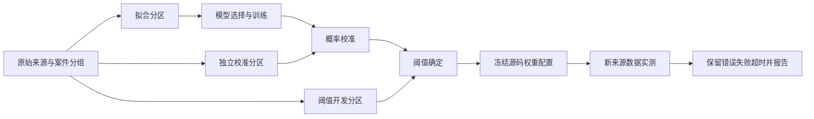

# 技术架构与处理流程

CF224冻结编码器的两整体视图与五个原始分辨率裁剪形成4608维表征，32隐藏单元MLP适配来源。图片生成与编辑分别校准，单调联合。视频条件证据树结合关键帧来源、连续窗口TCN、TruFor区域及一致性特征。SIFT+RANSAC附加光度可靠性，密集候选用真实RGB验证。

## 研究验证流程

标签、文件名、工具来源、编辑掩码不进入推理特征。数据增强与原件不跨分区。图文冲突和元数据缺失单独解释，不直接当作AI或欺诈真值。视频最多32个不同PTS帧，未采样间隔为未知，当前不做语音鉴伪。

前端React/Vite，后端FastAPI，PyAV媒体解码，RapidOCR文字提取，PyTorch视觉推理。材料与案件存本地目录和索引；服务仅监听127.0.0.1，无公网部署。
